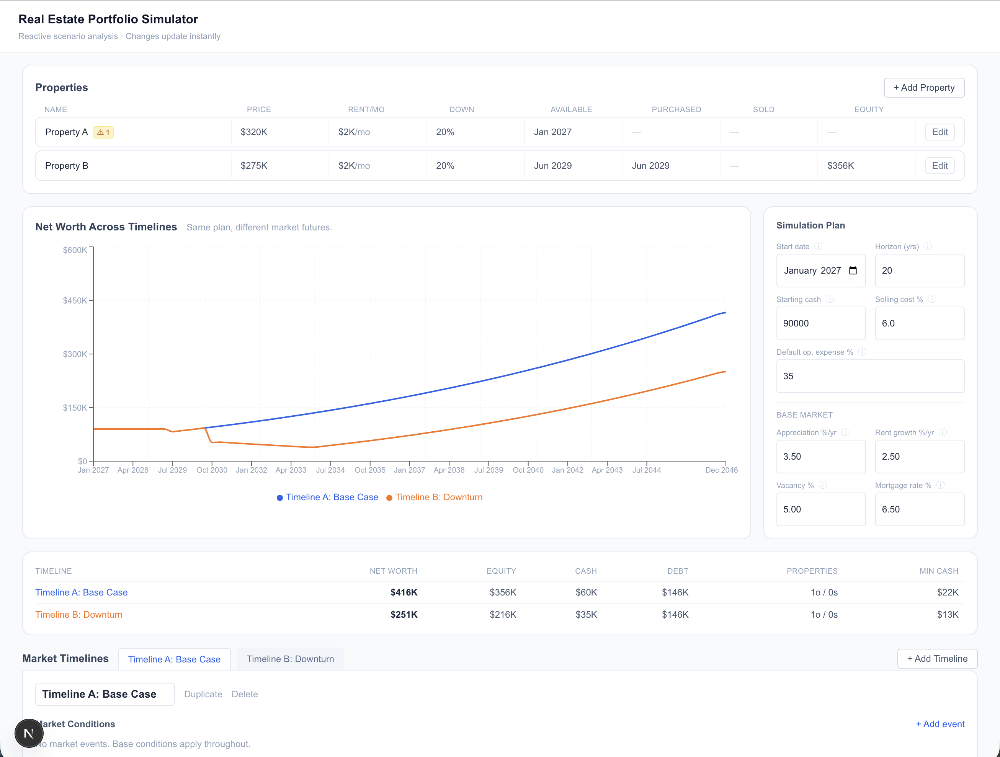

# Real Estate Portfolio Simulator

A reactive scenario-modeling tool for exploring how property acquisitions perform under changing market conditions.

**Live demo:** [re-strategy-sim.vercel.app](https://re-strategy-sim.vercel.app/)



## What it does

- Month-by-month simulation over a configurable horizon from a user-defined start date
- Multiple property acquisition opportunities with individual terms (price, rate, reserves, hold period)
- Date-based acquisition eligibility — the engine determines when each property can actually be purchased
- Fixed-rate mortgage amortization per property
- Rental cash flow with vacancy, operating expenses, and rent growth
- Configurable market timelines with date-ranged events (appreciation, vacancy, mortgage rates, etc.)
- One-time shocks (property value crashes, expense events, rent adjustments)
- Property sales with configurable hold periods and equity thresholds
- **Multiple market timelines** — the same portfolio plan runs against every timeline simultaneously
- **Advisory layer** — deterministic, explainable recommendations per timeline with plan-variant comparison
- **Domain validation** — reactive cross-field sanity checks with inline feedback (see below)
- Reactive visualization — no Run button; results derive from inputs via `useMemo`
- Structured event history with acquisition explanations
- Info tooltips on every input field
- Mobile-responsive layout — full dashboard on desktop, progressive inspector on mobile

## Domain Validation

The simulator validates not only individual field values but cross-field and domain relationships. Three severity levels are used:

| Level | Meaning |
|-------|---------|
| **Error** | Impossible or invalid input — entity is marked as invalid |
| **Warning** | Technically valid but likely contradictory, risky, or surprising |
| **Info** | Unusual behavior worth understanding (e.g. a fixed rate overrides a timeline rate event) |

Validation is reactive — feedback updates as you type, with no submit button required.

### Example cross-field checks

**Sell threshold vs. down payment:**
A 5% sell-at-equity threshold is individually valid. But if the property has a 20% down payment, equity already exceeds the threshold at purchase. The simulator surfaces this as a warning rather than silently accepting the configuration:

> ⚠ Sell-at-equity threshold (5%) is at or below the starting equity from the down payment (20%). This property may qualify for sale immediately after the hold period.

**Other cross-field checks include:**
- Earliest purchase date after simulation end → Error
- Latest purchase date before simulation start → Error
- Market event entirely outside simulation horizon → Warning
- Two market events overlapping on the same attribute → Info (explains which event wins and why)
- Down payment + closing costs + reserve exceeds starting cash → Warning
- Baseline monthly cash flow is materially negative → Warning
- Property-specific fixed mortgage rate while timeline has a rate event → Info
- Property shock of −100% or worse → Error; −70% to −99% → Warning

### UI presentation

Validation badges appear inline on property rows and timeline tabs. Inside editors, messages appear next to the relevant field. Warnings do not block simulation — the simulator always runs. Only errors prevent meaningless configuration from entering the engine.

## Advisory Layer

The advisory system turns the simulator from a passive forecasting tool into an explainable decision-support tool.

### How it works

`generateRecommendations(plan, properties, timeline, result)` analyzes the simulation output for one selected timeline and produces a list of typed, structured recommendations. All logic is deterministic — same inputs always produce the same output. No AI or randomness is involved.

Recommendations are generated by comparing the current plan against counterfactual alternatives:

- **Delay**: test 3, 6, 9, 12, 18, 24-month purchase delays and pick the first one that materially improves minimum cash reserves or ending net worth
- **Sell**: detect upcoming negative value events (shocks or appreciation downturns) and compare selling-before vs holding-through using a separate simulation run
- **Hold**: when no downturn is ahead and cash flow is positive, flag transaction cost waste
- **Warning**: when a purchase leaves cash below the configured reserve threshold for a sustained stretch

Every recommendation includes:
1. **What** the simulator suggests
2. **Why** — the specific market event or cash condition that triggered it
3. **Modeled evidence** — approximate dollar impact from a counterfactual simulation
4. **Which timeline** it belongs to (recommendations are never generic across timelines)

### Accept / Reject workflow

Recommendations are non-destructive by default:

1. User reviews recommendations for the selected timeline
2. User accepts or rejects individual items
3. User clicks **Create Recommended Plan** to apply accepted items to a new plan variant
4. The original plan is never touched
5. Both variants run against all timelines simultaneously
6. A side-by-side comparison shows where the recommendation helps or hurts under each modeled future

This makes trade-offs visible: a recommendation that helps under a downturn timeline may hurt slightly under a base-case timeline. Users can see both.

### Important disclaimer

> The advisory system is scenario analysis, not real-world financial advice or market prediction. All recommendations are phrased as "The simulation suggests…", "Based on this scenario…", or "Consider…" and are based solely on the user-defined simulation assumptions.

### Plan variants

When a recommended plan is created:

- **Original Plan** — the baseline, always preserved
- **Recommended Plan — [Timeline Name]** — a copy with accepted recommendations applied

Users can rename, delete, or switch between variants at any time. The original is always recoverable.

## Property Sale Rules

Two independent parameters control when a property is sold:

- **Min hold years** — a hard floor; the property will never sell before this regardless of equity
- **Sell at equity %** — the trigger; once the hold period has elapsed, the property sells as soon as equity reaches this percentage of current value

Both conditions must be satisfied simultaneously. With no equity trigger set (`never`), the property holds for the full simulation horizon. With `minHoldYears: 0` and a trigger set, the property can sell as soon as the threshold is crossed.

The editor shows an inline warning if the threshold is already met at purchase (e.g. a 5% threshold with a 20% down payment), and an estimated sell date derived from the simulation result or an analytical approximation based on appreciation.

## Engineering Decisions

1. **Simulation engine is pure TypeScript, independent of React.** `runSimulation()` accepts a plan and a timeline and returns a serializable result. No React dependencies inside `src/simulation/`.

2. **There is no Run button.** The entire simulation result is derived state via `useMemo`. Any input change immediately re-derives all timeline results. This is possible because a 30-year monthly simulation is ~360 iterations — trivially fast.

3. **Portfolio plan and market timelines are intentionally separate domain concepts.** `SimulationPlan` captures investor decisions (properties, acquisition criteria, reserve requirements, sale rules). `MarketTimeline` captures external conditions (appreciation, rates, shocks). The same plan can be replayed against any number of timelines without duplicating business logic.

4. **Market conditions are date-ranged data, not hard-coded scenario logic.** There is no `if (recession)` anywhere. The engine resolves active events for each month by scanning `MarketEvent[]`. Resolution rule: for each attribute independently, the most recently started currently-active event wins. This allows overlapping events to compose freely.

5. **Property acquisition uses structured decision objects.** `evaluateAcquisition()` returns `AcquisitionDecision` with a typed reason (`eligible`, `insufficient-funds`, `insufficient-reserves`, etc.) rather than a boolean. This drives UI explanations and is independently testable.

6. **Simulations are deterministic.** Same `plan + timeline` always produces identical output. No randomness. This makes timeline comparison fair and testing reliable.

7. **Advisory recommendations use counterfactual simulation.** A delay recommendation is generated by actually running the simulation with the shifted purchase date and comparing the results — not by heuristic estimation. This keeps the advisory layer honest and testable.

8. **Skip events are suppressed intelligently.** The engine only records a skip event when the rejection reason changes — not every month. This demonstrates production-quality thinking about log volume.

9. **Validation is pure and reactive.** `runValidation({ plan, properties, timelines })` is a pure function that returns a flat `ValidationIssue[]`. It runs via `useMemo` and never blocks the simulation — warnings are advisory, not gatekeeping.

10. **Sale trigger logic is AND, not OR.** Min hold years and sell-at-equity are both required simultaneously. No trigger set means hold forever. This is explicitly tested to prevent regression.

## Architecture

```
React UI (page.tsx)
  ├── SimulationPlan state      (investor decisions)
  ├── PropertyOpportunity[] state
  ├── MarketTimeline[] state
  ├── PlanVariant[] state       (original + recommended)
  └── Recommendation[] state
        │
        ├─ useMemo ──→  timelines.map(t => runSimulation({ plan, properties, timeline: t }))
        │                         │
        │                 SimulationResult[]
        │                         │
        │     ┌───────────────────┼───────────────────┐
        │  ComparisonChart   PropertyOutcomes    generateRecommendations()
        │                                               │
        │                                      Recommendation[]
        │
        └─ useMemo ──→  runValidation({ plan, properties, timelines })
                                  │
                          ValidationIssue[]
                                  │
                    Badges on rows + inline field messages

src/simulation/
  engine/
    runSimulation.ts      — full simulation loop (7-phase monthly engine)
    ownedProperty.ts      — internal mutable property state
  acquisition/
    evaluateAcquisition.ts — typed acquisition decision
  sales/
    sellProperty.ts       — sale eligibility and proceeds
  mortgage.ts             — amortization
  market.ts               — market event resolution

src/advisory/
  types.ts                — Recommendation, PlanVariant, PlanChange
  generateRecommendations.ts
  purchaseRecommendations.ts — delay logic via counterfactual simulation
  saleRecommendations.ts  — sell/hold logic via counterfactual simulation
  applyRecommendation.ts  — pure: plan → new plan (non-destructive)
  comparePlans.ts         — run both variants against all timelines

src/validation/
  types.ts                — ValidationIssue, severity, scope types
  validatePlan.ts
  validateProperty.ts
  validateSaleRules.ts    — cross-field sell threshold vs. down payment
  validateMarketEvent.ts
  validateOneTimeEvent.ts
  validateTimeline.ts     — composes per-event + overlap detection
  validateCrossFieldRules.ts — plan×property cross-checks
  index.ts                — runValidation() entry point

src/components/
  validation/
    ValidationBadge.tsx   — compact inline severity + count badge
    ValidationMessages.tsx — expandable issue list by severity
  property/
    PropertyTable.tsx     — badges per row
    PropertyEditor.tsx    — inline field messages
  timeline/
    TimelineWorkspace.tsx — timeline-level badges and messages
    MarketEventRow.tsx    — per-event badges
```

## Monthly simulation ordering

Each month processes in this order (ordering matters — it affects results):

1. Announce market event boundaries
2. Apply one-time events (shocks fire exactly once, tracked by ID)
3. Appreciate property values and grow rents
4. Collect rent, deduct vacancy + expenses + mortgage payments
5. Evaluate and execute sales
6. Evaluate and execute acquisitions (earliest availability first, at most one/month)
7. Record monthly snapshot

Sales happen before acquisitions so that sale proceeds can fund the same month's purchase.

## Alternate Market Timelines

The investment plan and market environment are modeled separately. The same property-acquisition plan can be evaluated against multiple independent future timelines. This makes it possible to compare:

- What if appreciation remains stable?
- What if a recession begins in 2031?
- What if mortgage rates rise before Property B becomes affordable?
- What if property values crash but rents remain stable?

Market timelines are pure data — the engine has no knowledge of timeline names like "Recession" or "Boom".

## Assumptions / Simplifications

- No taxes (no capital gains, no depreciation, no income tax on rent)
- No refinancing — mortgages are fixed-rate for their full term
- Homogeneous property model — no neighborhood-specific data
- Simplified operating expenses — a flat percentage of gross rent
- Deterministic market conditions — user-supplied, not stochastic
- JavaScript numeric precision — no decimal library; acceptable for scenario modeling
- At most one acquisition per calendar month

## Testing

```
npm test
```

77 tests across 4 files:

**Mortgage** (`simulation.test.ts`)
- Monthly payment calculation for 30-year fixed at 7%
- Balance reduces after each payment
- Balance reaches ~zero after full amortization, never goes negative
- Zero-rate mortgage amortizes as equal principal payments

**Market event resolution** (`simulation.test.ts`)
- Returns base conditions when no events are active
- Applies event that starts on exact date
- Does not apply event before its start date
- Does not apply event after its end date
- Later-starting event wins for same attribute when both active
- Overlapping events with different attributes compose freely

**Acquisition evaluation** (`simulation.test.ts`)
- Rejects purchase before availability date
- Rejects when insufficient funds for down payment
- Rejects when reserve requirement would be violated
- Allows purchase when all criteria met
- Rejects after latest purchase date

**Simulation integration** (`simulation.test.ts`)
- Purchases a property when cash becomes sufficient
- Does not purchase a property when cash is always insufficient
- Does not purchase same property twice
- Cannot sell before minimum hold period
- Net worth invariant: cash + propertyValue − debt in every snapshot
- Property value shock applies exactly once
- Sale deducts selling costs and pays off mortgage

**Multi-timeline** (`simulation.test.ts`)
- Same plan / different timelines produce different results
- Identical timelines produce identical results
- Market rate event changes mortgage rate on new purchases during that period
- Changing market rate does not modify existing fixed-rate mortgage
- Determinism: same plan+timeline inputs produce identical results

**Sell trigger logic** (`sell.test.ts`)
- `sellWhenEquityPct` undefined → never auto-sells (regression test for the default-sell bug)
- Explicitly undefined `sellWhenEquityPct` → never sells (belt-and-suspenders)
- Hold period not yet met → no sale even with equity above threshold
- Hold period just met with trigger set → returns SaleResult with correct fields
- Equity below threshold → no sale
- `sold: true` → returns null immediately
- `minHoldYears: 0` with trigger → sells immediately when equity exceeds threshold
- Same with purchase date = evaluation date (0 months held satisfies minHoldYears 0)

**Sell integration** (`sell.test.ts`)
- No auto-sell without trigger: status remains `purchased` after 20-year horizon
- Auto-sell fires after hold period when trigger is set
- Sale proceeds return to cash: ending net worth is positive
- Multiple properties: only the one with a trigger sells
- Hold through market downturn: no trigger = property still held
- Net worth invariant holds through a sale

**Equity threshold controls sale date** (`sell.test.ts`)
- Higher equity threshold delays sale relative to lower threshold
- Threshold below starting equity fires at first eligible month (hold period boundary)
- Threshold above starting equity fires only after appreciation builds enough equity
- Threshold set so high it is never reached: property holds for full horizon
- No sell trigger: property never sells regardless of equity accumulated

**Acquisition integration** (`sell.test.ts`)
- Property purchased at earliest available date when sufficient cash
- Property not purchased after `latestPurchaseDate` passes with insufficient cash
- Reserve requirement blocks purchase when cash would fall below threshold

**Advisory** (`advisory.test.ts`)
- Recommendations scoped to the correct timeline
- Applying a recommendation returns a new plan (non-destructive)
- Reserve warning generated when cash dips below threshold
- Delay recommendation generated when delaying improves reserves
- Sale recommendations scoped to correct property
- Determinism: same inputs produce same recommendations
- Plan variant apply: accepted recs modify the new variant
- Original plan immutability: original is never mutated
- Cross-timeline comparison runs both variants against all timelines
- Comparison diffs are computed correctly
- Recommendation beyond `latestPurchaseDate` is not generated
- Recommendation before property availability is not generated

**Validation** (`validation.test.ts`)
- 20% down + 5% sell-equity threshold → warning (`sell-threshold-below-down-payment`)
- 20% down + 50% sell-equity threshold → no such warning
- Latest purchase before earliest → error
- Property available after simulation end → error/warning
- Market event outside simulation horizon → warning
- Two overlapping events on same field → info with precedence explanation
- Two overlapping events on different fields → no conflict warning
- −100% property value shock → error
- −80% property value shock → warning, not error
- Negative baseline cash flow → warning
- Zero rent → warning
- Unusually high mortgage rate → warning
- Fixed property rate with timeline rate event → info

## Getting Started

```bash
npm install
npm run dev
```

Open [http://localhost:3000](http://localhost:3000).

## AI Strategy Advisor (optional, local dev only)

The AI Strategy Advisor analyzes the investment plan across every configured market timeline. It is entirely optional — the simulator, advisory rules, and all other features work without it.

The advisor requires a local API key and is not available on the public Vercel demo (keys are never committed or exposed to the browser).

### How it works

The deterministic simulator does all the financial calculations. The LLM:
- interprets the user's natural-language goal into structured criteria
- receives simulator-measured results for the current plan and candidate alternatives across every timeline
- synthesizes tradeoffs and explains recommendations
- never invents financial figures — all numbers it references come from simulation output

### Setup

1. Copy `.env.example` to `.env.local`:

   ```bash
   cp .env.example .env.local
   ```

2. Choose a provider and set its model in `.env.local`:

   ```
   # OpenAI
   AI_PROVIDER=openai
   AI_MODEL=gpt-4o-mini
   OPENAI_API_KEY=sk-...

   # Anthropic
   AI_PROVIDER=anthropic
   AI_MODEL=claude-haiku-4-5-20251001
   ANTHROPIC_API_KEY=sk-ant-...

   # xAI
   AI_PROVIDER=xai
   AI_MODEL=grok-beta
   XAI_API_KEY=xai-...
   ```

3. Restart the dev server:

   ```bash
   npm run dev
   ```

The **AI Strategy Advisor** panel will appear between the KPI summary and the Market Timelines section. If the key is missing or misconfigured, the panel shows setup instructions and the rest of the app is unaffected.

> `.env.local` is gitignored. Never commit API keys.

### Example goals

The advisor ships with seven saved goals selectable from a dropdown, or you can type any custom goal:

| Goal | What it optimizes for |
|------|----------------------|
| **Balanced Resilience** | Strong net worth without over-fitting to the Base Case |
| **Protect $25K Cash** | Maximize net worth while keeping ≥ $25,000 in reserves |
| **Downturn Resilience** | Survival and liquidity in the worst-performing timeline |
| **Maximum Growth** | Highest long-term net worth, willing to accept leverage |
| **Acquire All Properties** | Buy everything as early as safely possible |
| **Minimize Debt** | Lower leverage while preserving reasonable growth |
| **Worst-Case Focus** | Optimize primarily for the weakest timeline |

Custom goal examples:
- *"I want to retire the mortgages as quickly as possible while still buying Property C."*
- *"I do not want cash reserves to fall below $40,000."*
- *"Find the smallest difference between my best and worst timeline outcomes."*

### Suggested demo flow

1. Use the default portfolio (two properties, two timelines).
2. Add a third timeline — duplicate **Timeline B: Downturn** and adjust the recession dates.
3. Select **Protect $25K Cash** from the saved goals dropdown.
4. Click **Analyze Across 3 Timelines**.
5. Review the interpreted goal and cross-timeline recommendation table.
6. Accept a recommendation and click **Create AI Recommended Plan**.
7. Compare Original vs. AI Recommended Plan across all timelines in the Plan Comparison section.

## Default Scenario Walkthrough

The app opens with a pre-configured scenario designed to demonstrate all major features. Here's what you should see and be able to do immediately — no setup required.

### What's pre-loaded

**Two properties:**

| | Property A | Property B |
|--|--|--|
| Price | $320,000 | $275,000 |
| Rent | $2,400/mo | $2,100/mo |
| Down payment | 20% | 20% |
| Available | Jan 2027 | Jun 2029 |
| Min hold | 3 years | 5 years |

**Starting cash:** $90,000 — tight enough that purchasing Property A immediately leaves reserves near the $20,000 threshold, making the advisory interesting.

**Two market timelines:**

- **Timeline A: Base Case** — no events, steady 3.5% appreciation throughout the 20-year horizon
- **Timeline B: Downturn** — a housing correction shock (−15%) in Sep 2030, followed by a recession Jan 2031–Dec 2033 (−2% appreciation, 14% vacancy)

### What you should see

**Properties section (top):** Both properties listed with their simulation outcomes — purchased dates, sold dates (if applicable), and equity. Click **Edit** on either property to open the inline editor.

**Chart:** Two diverging net worth lines — Timeline A grows steadily, Timeline B dips during the 2030–2033 period then partially recovers.

**KPI row:** Side-by-side ending net worth, equity, cash, and min-cash for both timelines. The Downturn timeline will show materially lower numbers.

### Advisory recommendations

Switch between timeline tabs and open the **Advisory** section inside each to see scenario-specific recommendations:

**Timeline A: Base Case**
- **Hold Property A** — no downturn ahead, cash flow is positive, selling would waste ~$19K in transaction costs. The simulation suggests holding produces the stronger outcome.
- Possibly a **reserve warning** for Property B depending on cash available when it becomes purchasable in mid-2029.

**Timeline B: Downturn**
- **Sell Property A before the Sep 2030 shock** — the 3-year hold period expires before the shock hits, so selling in mid-2030 avoids the −15% value correction. The counterfactual simulation quantifies the approximate net worth improvement.
- **Reserve warning or delay rec for Property B** — purchasing Property B in 2029 may push cash reserves close to the threshold under the downturn scenario.

Each recommendation shows:
1. The suggested action and estimated dollar impact
2. A "reasoning" section explaining which market event triggered it and how the counterfactual was computed
3. **Accept** or **Reject** buttons — accepting multiple recommendations and clicking **Create Recommended Plan** builds a non-destructive variant you can compare against the original across both timelines

### Things to try

- **Edit Property A's min hold years** — set it to 10 and watch the sell-before recommendation on Timeline B change to an informational warning (can't sell before the shock anymore)
- **Change the shock magnitude** on Timeline B — reduce it below −5% and the sell rec may disappear; increase it to −30% and the benefit grows
- **Add a third timeline** — click "+ Add Timeline", duplicate Timeline B, and give it different recession timing to see how the same plan performs under three futures simultaneously
- **Accept the sell recommendation** on Timeline B and create a Recommended Plan — the Plan Comparison section at the bottom shows how the variant performs vs. the original on every timeline
- **Lower starting cash to $70,000** — Property A becomes unaffordable at purchase time and the simulator will show acquisition delay events explaining why

## Future Improvements

- Seeded Monte Carlo uncertainty bands
- Refinancing logic
- Property-specific expense schedules
- Capital gains and depreciation modeling
- Import historical market data
- Visual drag-to-resize timeline editor
- Scenario import/export (JSON)
